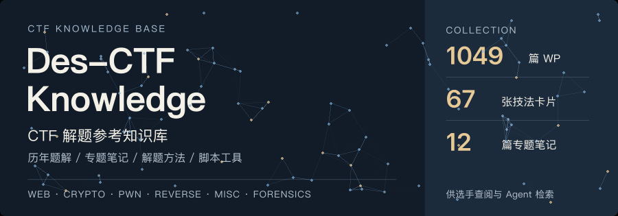
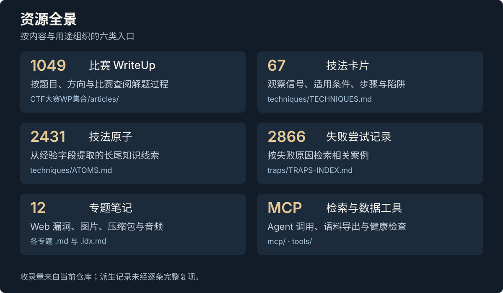
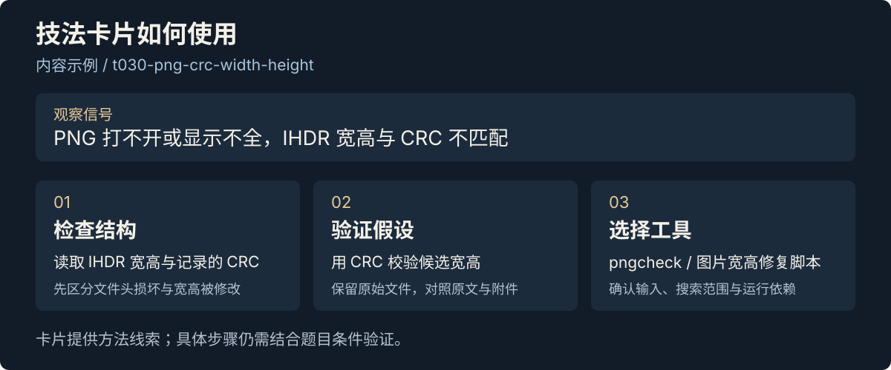
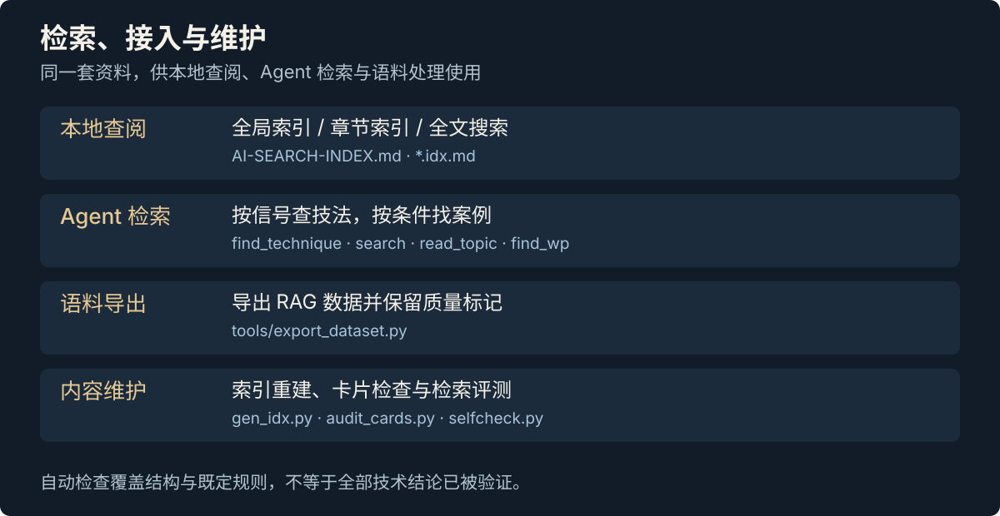

<p align="center">
  
</p>
<p align="center">
  <a href="https://github.com/Dest1ny-Sec/Des-CTF-Knowledge/releases/latest"></a>
  &nbsp;·&nbsp;
  <a href="assets/readme/hero.svg">静态封面</a>
</p>

<h1 align="center">Des-CTF-Knowledge</h1>

面向 CTF 选手与 AI Agent 的解题参考知识库，收录历年比赛 WriteUp、漏洞专题笔记、解题方法和常用脚本，支持按知识点、题目特征和比赛信息检索。

当前收录 1049 篇大赛 WP、67 张技法卡片和 12 篇专题笔记，内容涉及 Web、Crypto、Pwn、Reverse、Misc 与取证。摘要、关联及代码尚未全部完成人工核验或运行验证。

<p align="center">
  <a href="AI-SEARCH-INDEX.md">全局索引</a> &nbsp; / &nbsp;
  <a href="techniques/TECHNIQUES.md">技法卡片</a> &nbsp; / &nbsp;
  <a href="PAYLOAD-CHEATSHEET.md">Payload 速查</a> &nbsp; / &nbsp;
  <a href="CTF常用脚本及工具/SCRIPTS-INDEX.md">脚本工具</a> &nbsp; / &nbsp;
  <a href="mcp/README.md">MCP 接入</a>
</p>

---

## 内容索引

<p align="center">
  
</p>

做题卡住时，先用已经观察到的现象查方法，再对照案例确认适用条件。训练时，可以沿专题笔记学习，并用靶场 WP 对照练习。

| 内容 | 入口 |
| :--- | :--- |
| 解题方法与适用条件 | [技法卡片](techniques/TECHNIQUES.md) · [长尾技法索引](techniques/ATOMS.md) |
| 历年比赛解题过程 | [历年大赛 WP](CTF大赛WP集合/articles/) |
| 漏洞与知识点 | [全局索引](AI-SEARCH-INDEX.md) · [专题导航](#专题导航) |
| Payload 与脚本 | [Payload 速查](PAYLOAD-CHEATSHEET.md) · [脚本索引](CTF常用脚本及工具/SCRIPTS-INDEX.md) |
| 失败尝试与原因 | [失败尝试记录](traps/TRAPS-INDEX.md) |

## 解题方法与案例

技法卡片包含观察信号、解题步骤、适用差异和常见问题；技法原子补充长尾线索，失败记录保留尝试及原因。命中方法后，仍需回到关联 WP 核对题目条件。

<p align="center">
  
</p>

[查看技法卡片](techniques/TECHNIQUES.md) · [技法原子](techniques/ATOMS.md) · [失败尝试记录](traps/TRAPS-INDEX.md)

<details>
<summary><strong>查阅示例：PNG 文件打不开</strong></summary>

以“PNG 文件打不开”为例：

1. **定位方法**：在[技法卡片](techniques/TECHNIQUES.md)或[图片隐写笔记](图片隐写.md)中查找 PNG、IHDR、CRC 等关键词。
2. **核对前提**：检查文件签名、块结构和 CRC，判断是否属于宽高被修改的情况。
3. **参考案例**：沿卡片的出处找到 WP，对照题目条件与作者的操作。
4. **选择工具**：在[脚本索引](CTF常用脚本及工具/SCRIPTS-INDEX.md)中寻找宽高修复相关脚本，确认输入、依赖与参数后使用。

检索其他方向时，也应先确认题目条件，再对照技法与案例判断是否适用。

</details>

## 专题导航

### Web

| 专题 | 内容线索 |
| :--- | :--- |
| [SQL 注入](SQL.md) | 联合查询、报错、盲注、堆叠、过滤绕过 |
| [命令执行](命令执行.md) | 命令构造、无回显、过滤限制与历史技巧 |
| [文件上传](文件上传漏洞.md) | 类型校验、解析差异、路径与条件竞争 |
| [文件包含](文件包含.md) | PHP 协议、日志与 Session 包含 |
| [SSRF](SSRF漏洞.md) | URL 解析、协议、内网请求与过滤绕过 |
| [PHP 代码审计](php代码审计.md) | 类型比较、变量覆盖、函数特性 |
| [PHP 反序列化](PHP反序列化漏洞总结.md) | POP 链、字符逃逸、Phar 与原生类 |
| [SSTI](SSTI.md) | 模板探测、引擎识别与对象链 |
| [JWT](JWT.md) | 算法校验、密钥与 Header 参数 |

### Misc

| 专题 | 内容线索 |
| :--- | :--- |
| [图片隐写](图片隐写.md) | 文件结构、LSB、宽高修复与水印 |
| [压缩包分析](压缩包总结.md) | 伪加密、CRC、明文攻击与密码恢复 |
| [音频隐写](音频隐写.md) | 频谱、波形、DTMF 与音频工具 |

12 篇专题均配有 `.idx.md` 章节索引，例如 [SQL.idx.md](SQL.idx.md)，方便按标题和行号定位长文。历史技巧与固定索引 Payload 需要结合具体版本、配置和上下文判断。

<details>
<summary><strong>靶场与工具资料</strong></summary>

- [靶场 WP 汇总](WP汇总/)：ctfshow、SQLI-LABS、upload-labs 等相关练习资料。
- [脚本工具](CTF常用脚本及工具/)：RSA、Base 编码、CRC、USB 流量、图片处理等。
- [工具使用笔记](工具使用/)：sqlmap、ffuf、Dirsearch、Wireshark、tshark、内存取证等。

</details>

## 本地查阅

直接在 GitHub 阅读，或克隆到本地，用编辑器全文搜索：

```bash
git clone https://github.com/Dest1ny-Sec/Des-CTF-Knowledge.git
cd Des-CTF-Knowledge
```

安装了 [ripgrep](https://github.com/BurntSushi/ripgrep) 时，可以按问题查找：

```bash
# 查专题中的具体章节
rg -n '宽字节|二次注入' SQL.md

# 按观察信号查技法
rg -n -i 'PNG|IHDR|CRC' techniques/TECHNIQUES.md

# 找包含相关关键词的历史 WP
rg -l -i 'wakeup|反序列化' CTF大赛WP集合/articles/
```

## AI Agent 接入

<p align="center">
  
</p>

让 Agent 从[全局索引](AI-SEARCH-INDEX.md)开始，按需阅读专题、技法与 WP；也可以通过本仓库的 MCP Server 调用检索工具。

```bash
python3 -m venv .venv
source .venv/bin/activate
python3 -m pip install mcp pyyaml
python3 mcp/server.py
```

上面的激活命令适用于 macOS / Linux。服务使用 **stdio**，由 MCP 客户端启动和通信；完整配置见 [MCP 接入说明](mcp/README.md)，检索与证据使用约定见 [SKILL.md](SKILL.md)。

| 检索任务 | 工具 |
| :--- | :--- |
| 从信号找技法 | `find_technique` |
| 搜专题、读章节 | `search` · `read_topic` |
| 找历史题目与解题过程 | `find_wp` |
| 找 Payload | `get_payload` |

建议给 Agent 的任务描述：

> 已观察到 PHP 反序列化入口，源码中存在 `__wakeup`。请先确认版本和触发条件，再检索相关技法与 WP；列出适用前提、来源文件和仍需验证的部分。

<details>
<summary><strong>RAG 语料导出</strong></summary>

```bash
python3 tools/export_dataset.py --format rag --out exports/
```

导出格式与字段说明见 [数据贡献指南](CONTRIBUTING-DATA.md)。接入前先阅读[数据质量报告](DATA-QUALITY.md)，结合质量标记过滤或降权；代码、摘要和自动抽取内容需要核对来源。

</details>

## 审核、验证与数据工具

项目提供卡片审核、数据修复、索引检查与检索评测工具。审核状态的依据与范围应结合具体记录判断，不能将自动检查通过等同于完整复现。

| 内容 | 入口 |
| :--- | :--- |
| 卡片审核过程与修订依据 | [审核报告](techniques/review/REVIEW-REPORT.md) · [卡片整理记录](techniques/CARDS-CLEANUP.md) |
| 解题方向验证与实验限制 | [有效性验证报告](techniques/VALIDATION.md) |
| 原始语料缺陷与统计口径 | [数据质量报告](DATA-QUALITY.md) |
| 数据字段、贡献与导出规范 | [数据贡献指南](CONTRIBUTING-DATA.md) |
| 本地检查与持续集成 | [健康检查脚本](tools/selfcheck.py) · [GitHub Actions](.github/workflows/knowledge-ci.yml) |

```bash
# 检查专题索引与正文是否一致
python3 tools/gen_idx.py --check

# 检查卡片结构和既定规则，不改写文件
python3 tools/audit_cards.py --dry-run

# 运行项目自检
python3 tools/selfcheck.py
```

## 已知限制

大赛 WP 采集语料存在图片缺失和代码格式损坏，复现时需要核对原文、附件与环境。

根据当前[数据质量报告](DATA-QUALITY.md)：

- **大赛 WP 图片被移除**：截图中的报错、反汇编与内存布局可能无法从正文恢复。该范围不代表仓库所有目录都没有图片。
- **约 57% 的代码块存在换行压平问题**：复制后可能无法运行，尤其需要检查缩进与字符串换行。
- **题面与答案信息不完整**：约 22% 的 WP 含明确题面，约 21% 含符合脚本规则的 flag；该规则不等于实际执行验证。
- **派生内容仍需核验**：2431 条技法原子与 2866 条失败尝试记录来自字段抽取，存在上下文丢失或关联不准的可能。

专题笔记和脚本也需要检查版本、依赖与适用条件。完整缺陷与统计口径见[质量报告](DATA-QUALITY.md)，近期修订见[更新记录](CHANGELOG.md)。

## 贡献与维护

欢迎补充原文证据、修正技术错误，以及恢复损坏的代码与图片。提交问题时，带上**文件位置、错误说明、适用环境和可核对的来源**，会更容易处理。

接下来的重点：

- [ ] 核验核心技法卡片的前提、步骤与证据关联。
- [ ] 将多题 WP 拆成能独立检索的单题案例。
- [ ] 为代表性案例补齐代码、附件与环境信息。
- [ ] 建立明确的审核状态，扩充独立检索与证据评测。

[报告问题](https://github.com/Dest1ny-Sec/Des-CTF-Knowledge/issues) · [数据规范](CONTRIBUTING-DATA.md) · [更新记录](CHANGELOG.md)

---

## 来源与许可

感谢 WP 原作者、赛事出题人与开源工具维护者。大赛 WP 主要收集自 [CTF IOT](https://www.ctfiot.com/) 等公开渠道，具体来源见文章中的原文链接。

本项目的汇编、组织及维护者原创内容采用 [MIT License](LICENSE)；收录文章和第三方脚本的权利与许可归原作者所有，使用或分发时请核对其原始许可。

本项目用于 CTF 训练、安全学习与授权测试。
